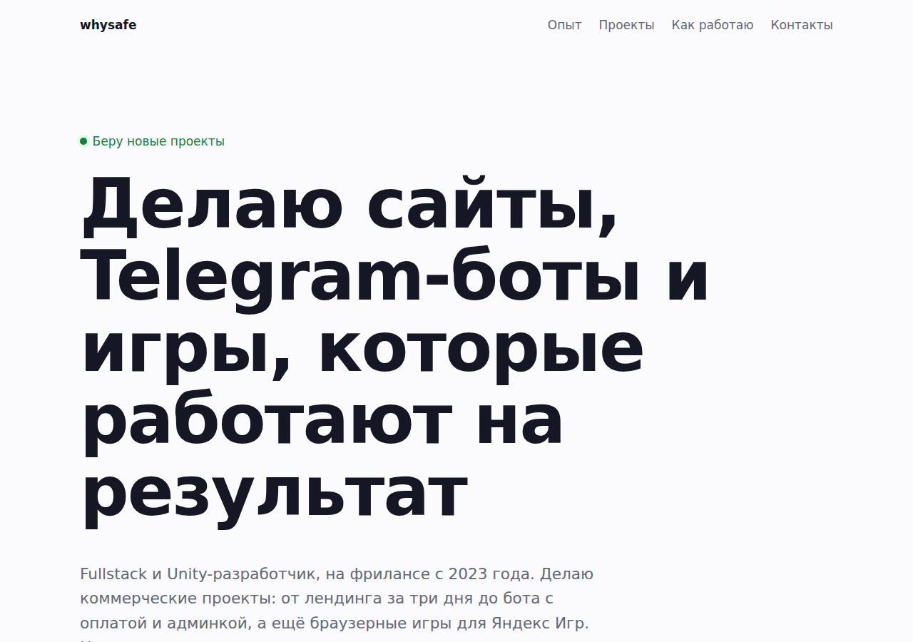

# Сайт-портфолио whysafe

Личный сайт разработчика на одной странице: услуги, опыт, проекты с фильтром по типу, процесс работы и контакты. Работает на GitHub Pages без сборки.



## Возможности

- Первый экран с коротким описанием и кнопками «Обсудить проект» и «Посмотреть работы»
- Пять направлений: сайты, Telegram-боты, Python, игры, серверы
- Блок «Опыт»: годы на фрилансе считаются автоматически от года начала, число отзывов, реальные направления работ, ссылка на профиль Kwork
- Каталог из 49 проектов с фильтрами: сайты, веб-приложения, игры, боты, Python, Android, серверы; у каждого фильтра счётчик
- Карточка проекта: тип, описание, ключевые фичи, стек, ссылки «Открыть» и «Код на GitHub»
- Четыре шага работы с заказчиком
- Контакты: Telegram, сайт, почта, Kwork, канал
- Адаптивная вёрстка от 320 px до широких экранов

## Стек

HTML, CSS (Grid), JavaScript без библиотек.

## Как запустить

Сборка не нужна: откройте `index.html` в браузере. Или через локальный сервер:

```bash
python -m http.server 8000
```

## Настройка

- **Проекты:** массив `PROJECTS` в `index.html`. Новый проект добавляется одним объектом: `repo`, `kind`, `label`, `title`, `text`, `feats`, `stack`; `demo: true`, если у репозитория включён GitHub Pages; `wide: true`, чтобы карточка занимала две колонки.
- **Опыт:** объект `EXPERIENCE` в начале скрипта. Блок появляется, только когда заполнен год начала работы.
- **Контакты:** список в секции `#contact`.

## Структура проекта

```
index.html   # разметка, стили и скрипты в одном файле
```

## Как это устроено

- Ник GitHub берётся из адреса сайта на GitHub Pages, поэтому ссылки на код и живые версии проектов строятся сами, без правки кода после публикации. При открытии файла локально подставляется `whysafe`.
- Карточки и фильтры рендерятся из массива данных, разметка проектов не дублируется.
- Блок опыта скрыт, пока нет данных: на сайте не бывает пустых заглушек.
- Колонки сетки получают `min-width: 0`, поэтому длинные ссылки и адреса не растягивают страницу на телефоне.

## Идеи для развития

- Скриншоты проектов в карточках
- Переключатель светлой и тёмной темы
- Английская версия страницы

## Лицензия

MIT © 2026 whysafe. Telegram: [@yawhysafe](https://t.me/yawhysafe) · Сайт: [whysafe.ru](https://whysafe.ru)
